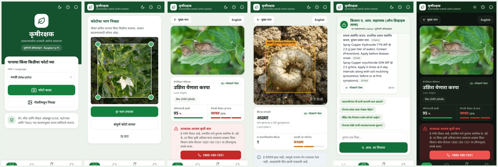

# KrishiRakshak - offline crop disease and pest advisor (Bharat AI-SoC Challenge 2026-27, PS1)

KrishiRakshak turns one photo of a tomato leaf or an insect into checked advice in the farmer's language, fully
offline on a Raspberry Pi 5 (8 GB, CPU only). The farmer's phone joins the Pi's own Wi-Fi hotspot; one C++ program on
the Pi finds the crop, the disease and the insects, measures how much of the leaf is affected, looks up verified
practices from ICAR, NIPHM and TNAU publications, has Llama 3.2 1B (ExecuTorch, INT4) explain them in simple words,
checks every sentence against the sources and translates the answer into one of 10 Indian languages. Severe cases are
routed to the local KVK and the Kisan Call Centre.



## How it works

```
Phone (Android app or browser)  --Wi-Fi hotspot of the Pi, no internet-->  Raspberry Pi 5: one C++ program
  photo -> photo check (OpenCV)
        -> in parallel: tomato-leaf check (EfficientNet-B0) | disease classifier (EfficientNet-B0 INT8)
                        | pest detector by advice group (YOLOv8n INT8)
        -> severity: lesion share of the leaf (LR-ASPP MobileNetV3 segmentation)
        -> verified extracts for the result (SQLite knowledge base, ICAR / NIPHM / TNAU, 10 languages)
        -> Llama 3.2 1B + LoRA (ExecuTorch, INT4, XNNPACK): rewrites the extracts in simple words
        -> grounding check: each sentence must match one source sentence, otherwise it is dropped
        -> IndicTrans2 200M (CTranslate2 INT8): translation of the checked English
  <- one JSON answer -> result screen, read aloud with the phone's offline voice
```

Llama gets a one-line structured result and the selected extracts, never the image. Spray products and doses are shown
exactly as published and are never rewritten or translated.

## Results (Raspberry Pi 5 and held-out test photos)

| What | Result |
|---|---|
| Disease classifier, 6 tomato classes | 98.7% on lab photos (PlantVillage); 76% on field photos (PlantDoc), 88% on the field photos it answers (below 0.85 confidence it says "uncertain") |
| Tomato-leaf check | 94.6% of other crops, insects and objects rejected; 4.8% of tomato field photos rejected in error |
| Pest detector (6 advice groups) | insect found 85-98% (IP102 test, independent photos); right advice group 26% on 578 independent pest photos (species model before: 13%) |
| Severity | level agrees with plant pathologists on 61% of 91 field photos (colour rule before: 31%); lesion Dice 0.54 |
| Speed on the Pi 5 | vision 0.12 s; Llama about 14 tokens/s, first token 2.5-3.5 s; full answer median 8.3 s (4.7-20 s) |
| Memory and power | Llama INT4 peak 1.25 GB, whole app about 2 GB of 8 GB; 5.5 W board power during an answer, 1.45 W idle |
| End-to-end tests | 37 test photos x 10 languages = 370 runs through the API and 370 through the app, no failures |

Details, with every test set and the FP32 / INT8 / INT4 comparisons: [docs/RESULTS.md](docs/RESULTS.md),
[docs/SEVERITY.md](docs/SEVERITY.md), [docs/TRANSLATION_INDICTRANS2.md](docs/TRANSLATION_INDICTRANS2.md),
[docs/llama_1b_quality.md](docs/llama_1b_quality.md).

## Run it on a Raspberry Pi 5

Needs: Raspberry Pi 5 (8 GB) with Raspberry Pi OS (Trixie, 64-bit), OpenCV (`sudo apt install libopencv-dev`), a PC
with Ubuntu for cross-compiling, and the GitHub CLI (`gh`).

1. Download the models (not stored in git) into `models/`, as described in [models/README.md](models/README.md):
   ```
   for r in models-v5 models-v4 models-v3 models-v2 llm-v2 llm-v1; do
     gh release download $r --repo ashwinambatwariitm/krishirakshak-ps1 --dir models
   done
   tar -xzf models/indictrans2_en_indic_200M_ct2_int8.tar.gz -C models
   ```
2. Build the dependencies (ONNX Runtime 1.23.2, ExecuTorch 1.5.1, CTranslate2 4.6.0) and the program for the Pi, as in
   [cpp/README.md](cpp/README.md):
   ```
   cmake -S cpp -B build/arm -G Ninja -DCMAKE_TOOLCHAIN_FILE=cpp/arm-toolchain.cmake \
     -DEXECUTORCH_ROOT=$HOME/arm_libs/executorch && cmake --build build/arm -j
   ```
3. Package everything the Pi needs and copy it over:
   ```
   bash cpp/package_pi.sh
   rsync -a dist/krishirakshak-pi/ <user>@<pi-address>:~/krishirakshak/
   ```
4. On the Pi, start the app at boot and switch on the offline hotspot (`KrishiRakshak`, password `krishi2026`):
   ```
   cd ~/krishirakshak
   sudo ./kr_pi.sh autostart-on
   sudo ./kr_pi.sh hotspot-test 300     # try first: back to the home Wi-Fi after 5 minutes
   sudo ./kr_pi.sh hotspot-on
   ```
5. On the phone: join the `KrishiRakshak` Wi-Fi (mobile data off or airplane mode with Wi-Fi on) and open
   `http://10.42.0.1:8080`, or install the Android app (below). A laptop on the same network can open the judge
   screen `http://10.42.0.1:8080/demo.html`: the app in a phone frame next to a live log of every model on the Pi.

## Android app

[app/android](app/android) wraps the same pages in an Android app with the phone's own offline voice for read-aloud.
The pages are copied into the app with `app/android/sync_web.sh`; build with `./gradlew assembleDebug` (JDK 17,
Android SDK 34). The app connects to `http://10.42.0.1:8080`.

## Develop and test on a PC

```
cmake -S cpp -B build/x86 && cmake --build build/x86 -j                 # vision + knowledge base
build/x86/krishirakshak --root . --no-llama leaf.jpg                     # JSON result for one photo
build/x86/krishirakshak --root . --serve 8080 --web app/web              # app at http://localhost:8080
ctest --test-dir build/x86                                               # grounding, translation, pest severity
python tools/mock_api_server.py                                          # app against saved example answers
```

The answer format is documented in [docs/APP_API.md](docs/APP_API.md); program options in [cpp/README.md](cpp/README.md).

## Training (Kaggle)

All models were trained on Kaggle (Tesla T4). The scripts in `training/src/` (one per experiment, cells separated by
`# %%`) are turned into notebooks with `python training/build_notebooks.py --kaggle-user YOUR_KAGGLE_NAME` and run
with `kaggle kernels push -p kaggle/<notebook>`; outputs are downloaded with `kaggle kernels output`. Datasets are
attached from Kaggle automatically. Before using GPU time, a script can be checked on fake data:

```
python training/smoke_test/make_fake.py /tmp/fake_data
KR_SMOKE=1 KR_INPUT=/tmp/fake_data KR_WORK=/tmp/fake_out python training/src/tomato_disease_v5.py
```

| Script | Model |
|---|---|
| `tomato_disease_v5.py`, `disease_v5_threshold.py` | disease classifier (6 classes) and its "uncertain" threshold |
| `leaf_check.py` | tomato-leaf check (v2 adds chilli, brinjal, bell pepper) |
| `pest_groups.py`, `pest_independent_test.py` | pest detector by advice group, independent pest test |
| `lesion_seg.py` | severity segmentation |
| `int8_ptq.py` | INT8 post-training quantization of the vision models |
| `llama_lora_distill.py`, `llama3b_export.py` | LoRA for Llama 3.2 1B, ExecuTorch export |
| `kb_translate.py` | knowledge-base translation (IndicTrans2) |

Rules that keep the test results honest: test photos are never used for training, checkpoint selection or threshold
tuning; photos of the same leaf and copies across datasets stay in one split; augmentation happens in memory during
training only; lab (PlantVillage) and field (PlantDoc) results are always reported separately.

## Repository layout

```
cpp/          the C++ program for the Pi (src/, tests/, tools/), packaging and the hotspot script (pi/kr_pi.sh)
app/web/      the farmer app (HTML, CSS, JavaScript, fonts) served by the Pi; demo.html = judge screen
app/android/  Android app around the same pages
app/kb/       verified knowledge base (ICAR, NIPHM, TNAU extracts) and its translations
training/     training scripts and the Kaggle notebook builder; kaggle/ = generated notebooks
tools/        evaluation, export, benchmark and translation tools
results/      metrics, confusion matrices, split manifests and Pi measurements of every run
docs/         results, design notes, API, severity, translation, Llama quality, roadmap
models/       README with download commands and checksums (model files are release assets)
```

## Licences

The source code of this repository is licensed under the GNU Affero General Public License v3.0 ([LICENSE](LICENSE)),
because the pest detector is built with Ultralytics YOLOv8 (AGPL-3.0) and the disease models are trained on
PlantVillage (CC BY-SA 3.0, whose authors ask that trained models follow the same licence).

| Component | Licence |
|---|---|
| Llama 3.2 1B (release assets llm-v1, llm-v2) | Llama 3.2 Community License, Copyright (c) Meta Platforms, Inc. All Rights Reserved; licence, use policy and notice in the release. Built with Llama. |
| IndicTrans2 (AI4Bharat) | MIT |
| ExecuTorch / ONNX Runtime / CTranslate2 / OpenCV | BSD / MIT / MIT / Apache 2.0 |
| SQLite / nlohmann json | public domain / MIT |
| Noto Sans fonts (app/web/fonts) | SIL Open Font License 1.1 (app/web/fonts/OFL.txt) |
| PlantVillage / PlantDoc / IP102 | CC BY-SA 3.0 / CC BY 4.0 / research terms of the IP102 authors |
| Red Chili Pepper Pests, Eggplant Disease Recognition, Solanaceae Leaves | Apache 2.0, CC BY 4.0, CC0 |
| Severity training data (Roboflow "tomato", Kaggle leaf disease segmentation) | CC BY 4.0, CC0 |
| Knowledge-base extracts | quoted from ICAR, NIPHM and TNAU publications, each with its source and link; the texts remain the publishers' |

The test photos used during development come from these datasets and are not redistributed here.
